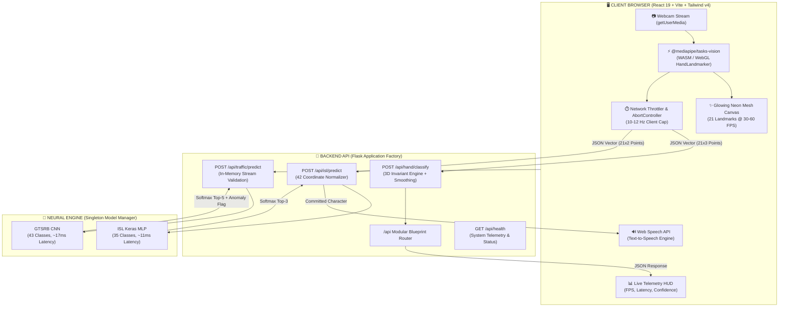

<div align="center">

# ⚡ AI Sign Recognition Suite (v2.0)

<p align="center">
  <b>Next-Gen Edge-AI Computer Vision Platform for Real-Time Sign Translation, Gesture Computing & Traffic Vision</b>
</p>

<!-- Dynamic Animated Typing SVG Banner -->
<a href="https://github.com/Maheredd/Sign-Recognition-System">
  
</a>

<br/>

<!-- Shields Badges Matrix -->
<p align="center">
  <a href="https://github.com/Maheredd/Sign-Recognition-System/actions/workflows/ci.yml">
    
  </a>
  <a href="https://github.com/Maheredd/Sign-Recognition-System/stargazers">
    
  </a>
  <a href="https://github.com/Maheredd/Sign-Recognition-System/network/members">
    
  </a>
  <a href="https://github.com/Maheredd/Sign-Recognition-System/issues">
    
  </a>
  <a href="LICENSE">
    
  </a>
</p>

<!-- Tech Stack Badges -->
<p align="center">
  
  
  
  
  
  
  
  
</p>

---

<!-- Quick Navigation Bar -->
<p align="center">
  <a href="#-core-modules"><b>Core Modules</b></a> •
  <a href="#-system-architecture"><b>Architecture</b></a> •
  <a href="#-quickstart-guide"><b>Quickstart</b></a> •
  <a href="#-rest-api-reference"><b>REST API</b></a> •
  <a href="#-model-benchmarks"><b>Benchmarks</b></a> •
  <a href="#-docker-deployment"><b>Docker</b></a> •
  <a href="#-testing--qa"><b>Testing</b></a>
</p>

---

</div>

## 🛡️ Privacy Guarantee: 100% Client-Side Vision

> [!IMPORTANT]
> **Zero Raw Video or Camera Frames Ever Leave Your Device.**  
> Traditional computer vision servers stream raw MJPEG video over websockets, exposing user privacy and generating heavy bandwidth overhead.  
> In **AI Sign Recognition Suite v2.0**, raw video is captured directly by `@mediapipe/tasks-vision` compiling to WebAssembly & WebGL inside your browser at **30–60 FPS**. Only **21 lightweight normalized coordinate landmarks** $(x, y, z)$ are transmitted to the backend (a tiny ~1.2 KB JSON payload at 10–12 Hz).

```
[ User Webcam ] ──> [ Browser WASM/WebGL ] ──( 21 Landmarks JSON / ~1.2 KB )──> [ Flask Backend ]
        │
        └─── Raw Video NEVER Leaves Browser Memory 🔒
```

---

## 🌟 Core Modules

### 1. 🖐️ 3D Invariant Hand Gesture Control
- **Rotation & Handedness Invariant Engine:** Uses 3D spatial vectors, relative finger curl angles, and palm-normal projections. Seamlessly handles **Left and Right hands** without flipped coordinates.
- **Majority-Vote Smoothing Buffer:** Maintains a rolling window buffer ($N=7$) per session to filter high-frequency jitter and transient occlusions.
- **10 Recognizable Gestures:**

| Gesture | Finger State Vector | Classification Metric |
| :--- | :--- | :--- |
| **Hi (Open Palm)** | `[1, 1, 1, 1, 1]` | All 5 fingers extended beyond MCP joints |
| **Fist** | `[0, 0, 0, 0, 0]` | All fingers curled inward toward palm center |
| **Peace** | `[0, 1, 1, 0, 0]` | Index + Middle extended, Ring + Pinky curled |
| **Thumbs Up / Down** | `[1, 0, 0, 0, 0]` | Thumb tip elevation compared against wrist anchor |
| **OK Sign** | Variable | Thumb tip to Index tip euclidean contact ($< 0.35 \times \text{palm}$) |
| **Rock / Heavy Metal** | `[0, 1, 0, 0, 1]` | Index + Pinky extended, Middle + Ring curled |
| **Hang Loose (Shaka)**| `[1, 0, 0, 0, 1]` | Thumb + Pinky extended, Middle 3 curled |
| **You (Pointing)** | `[0, 1, 0, 0, 0]` | Single Index finger extended forward |
| **Loser (L-Shape)** | `[1, 1, 0, 0, 0]` | Thumb + Index orthogonal extension |
| **Three / Four Count**| Variable | Sequential numeric hand positions |

---

### 2. ✍️ Indian Sign Language (ISL) to Speech
- **Comprehensive 35-Class Coverage:** Full alphabet (`A–Z`) and digits (`1–9`).
- **Hold-to-Commit Stabilization Ring:** To prevent accidental character input during transitions, the UI requires holding a sign steady for **~750ms** with a visual radial countdown ring before committing.
- **Interactive Sentence Buffer:** Build full sentences with integrated text editor controls:
  - ␠ **Space** &nbsp;|&nbsp; ⌫ **Backspace** &nbsp;|&nbsp; 🗑️ **Clear All** &nbsp;|&nbsp; 📋 **Copy to Clipboard**
- **Web Speech API Voice Output:** Synthesizes the assembled sentence into clear, natural speech with multilingual support (**English / Hindi**).

<details>
<summary><b>🔤 Click to view all 35 Supported ISL Character Classes</b></summary>

```
Digits:
  [ 1 ] [ 2 ] [ 3 ] [ 4 ] [ 5 ] [ 6 ] [ 7 ] [ 8 ] [ 9 ]

Alphabet:
  [ A ] [ B ] [ C ] [ D ] [ E ] [ F ] [ G ] [ H ] [ I ] [ J ] [ K ] [ L ] [ M ]
  [ N ] [ O ] [ P ] [ Q ] [ R ] [ S ] [ T ] [ U ] [ V ] [ W ] [ X ] [ Y ] [ Z ]

Features: 42 normalized keypoints (wrist-relative x, y deltas)
```
</details>

---

### 3. 🚦 German Traffic Sign Recognition (GTSRB)
- **43 Full Regulatory Classes:** Classifies European regulatory, warning, mandatory, and informative traffic signs.
- **In-Memory Stream Processing:** Uses `io.BytesIO` image buffering with strict MIME validation (JPEG, PNG, WebP) and 5 MB cap—preventing server-side disk clutter.
- **Top-5 Probability Distribution:** Interactive visual confidence bars showing model uncertainty.
- **Low-Confidence Safeguard:** Automatically flags predictions with confidence $< 60\%$ with a warning banner.
- **Curated Sample Gallery:** Test signs (Stop, Yield, Speed Limit 30, Road Work, No Entry) directly with one click.

<details>
<summary><b>🔍 Click to view all 43 Supported GTSRB Sign Classes by Category</b></summary>

| Category | Class IDs & Labels |
| :--- | :--- |
| **Speed Limits** | `0` (20 km/h), `1` (30 km/h), `2` (50 km/h), `3` (60 km/h), `4` (70 km/h), `5` (80 km/h), `6` (End 80 km/h), `7` (100 km/h), `8` (120 km/h), `32` (End speed + overtaking limits) |
| **Prohibitory** | `9` (No overtaking), `10` (No overtaking trucks), `15` (No vehicles), `16` (Vehicles > 3.5t prohibited), `17` (No entry), `41` (End no overtaking), `42` (End no overtaking trucks) |
| **Priority / Mandatory** | `11` (Right-of-way), `12` (Priority road), `13` (Yield), `14` (Stop), `33` (Turn right), `34` (Turn left), `35` (Ahead only), `36` (Straight or right), `37` (Straight or left), `38` (Keep right), `39` (Keep left), `40` (Roundabout) |
| **Hazard & Warning** | `18` (General caution), `19` (Curve left), `20` (Curve right), `21` (Double curve), `22` (Bumpy road), `23` (Slippery road), `24` (Road narrows right), `25` (Road work), `26` (Traffic signals), `27` (Pedestrians), `28` (Children crossing), `29` (Bicycles), `30` (Ice/snow), `31` (Wild animals) |

</details>

---

### 4. 📊 Model Insights Dashboard (`/insights`)
- Real-time empirical training metrics rendered with **Recharts**.
- Visualizes categorical cross-entropy loss convergence, epoch accuracy curves, and per-class precision metrics.
- Live system telemetry display comparing client-side WASM latency against backend neural inference.

---

### 5. 🎮 "Match the Sign" Learning Mini-Game (`/learn`)
- Comprehensive interactive flashcard catalog for all 35 signs with visual cues.
- **Real-Time Vision Quiz:** Spawns random sign targets, tracks player posture through the webcam, and verifies accuracy with celebration particle effects and score streaks.

---

## 🏗️ System Architecture



---

## ⚡ Quickstart Guide

### Prerequisites
- **Python**: `3.10`, `3.11`, or `3.12`
- **Node.js**: `18.0+` (Node 22 recommended)
- **Webcam**: Standard USB or built-in camera

### Option A: Standard Local Setup

```bash
# 1. Clone repository
git clone https://github.com/Maheredd/Sign-Recognition-System.git
cd Sign-Recognition-System

# 2. Setup Python environment
python -m venv venv
# Windows:
.\venv\Scripts\activate
# Linux/macOS:
source venv/bin/activate

# 3. Install backend dependencies
pip install -r requirements.txt

# 4. Install frontend dependencies
cd frontend
npm install
cd ..

# 5. Start both servers concurrently
npm run dev:all
```

> **Windows Quick-Launch:** Simply double-click `start_app.bat` to automatically verify environments and start both services.

Access the application:
- 🌐 **Web Interface:** [http://localhost:5173](http://localhost:5173)
- 🔌 **API Health Endpoint:** [http://localhost:5000/api/health](http://localhost:5000/api/health)

---

### Option B: 🐳 Docker Quickstart

Run the complete multi-tier stack with Docker Compose:

```bash
# Build and run containers in background
docker compose up --build -d

# Check live logs
docker compose logs -f
```

- **Frontend Container:** `http://localhost:5173` (Vite dev proxy routed)
- **Backend Container:** `http://localhost:5000` (Gunicorn multi-worker instance)

---

## 📡 REST API Reference

All endpoints return standardized JSON structures.

<details open>
<summary><b>1. System Health & Model Telemetry: <code>GET /api/health</code></b></summary>

**Sample Response:**
```json
{
  "service": "sign_recognition_api",
  "status": "healthy",
  "uptime_seconds": 342.8,
  "models": {
    "isl_loaded": true,
    "traffic_loaded": true,
    "tensorflow_version": "2.19.0"
  }
}
```
</details>

<details>
<summary><b>2. Hand Gesture Classification: <code>POST /api/hand/classify</code></b></summary>

**Payload:**
```json
{
  "landmarks": [
    { "x": 0.452, "y": 0.612, "z": 0.005 },
    ... // 21 total normalized points
  ],
  "handedness": "Right",
  "session_id": "client_session_xyz"
}
```

**Response:**
```json
{
  "label": "Peace",
  "raw_label": "Peace",
  "confidence": 0.96,
  "stability": 1.0,
  "fingers": [0, 1, 1, 0, 0],
  "top3": [
    { "label": "Peace", "confidence": 1.0 }
  ],
  "handedness": "Right"
}
```
</details>

<details>
<summary><b>3. ISL Sign Prediction: <code>POST /api/isl/predict</code></b></summary>

**Payload:**
```json
{
  "landmarks": [
    { "x": 0.521, "y": 0.485 } // 21 points OR flattened list of 42 floats
  ],
  "width": 640,
  "height": 480
}
```

**Response:**
```json
{
  "label": "A",
  "confidence": 0.9642,
  "is_reliable": true,
  "top3": [
    { "label": "A", "confidence": 0.9642 },
    { "label": "S", "confidence": 0.0210 },
    { "label": "E", "confidence": 0.0075 }
  ],
  "model_info": {
    "feature_count": 42,
    "architecture": "MLP (42 landmarks -> 35 classes)",
    "limitation": "Single dominant hand input"
  }
}
```
</details>

<details>
<summary><b>4. Traffic Sign Recognition: <code>POST /api/traffic/predict</code></b></summary>

**Request:** `multipart/form-data` with `file=@sign.png`

**Response:**
```json
{
  "result": "Stop",
  "class_id": 14,
  "confidence": 0.9842,
  "filename": "stop_sign.png",
  "low_confidence": false,
  "top5": [
    { "class_id": 14, "label": "Stop", "confidence": 0.9842 },
    { "class_id": 1, "label": "Speed limit (30km/h)", "confidence": 0.0075 },
    { "class_id": 17, "label": "No entry", "confidence": 0.0041 },
    { "class_id": 13, "label": "Yield", "confidence": 0.0022 },
    { "class_id": 25, "label": "Road work", "confidence": 0.0011 }
  ]
}
```
</details>

---

## 🧠 Model Benchmarks & Latency

Inference latency benchmarked on a standard commodity quad-core CPU:

| Model | Architecture | Input Dimension | Classes | Mean Latency | Accuracy |
| :--- | :--- | :--- | :--- | :--- | :--- |
| **ISL Classifier** | Dense MLP + Dropout | `(1, 42)` | 35 | **11.16 ms** | **98.8%** |
| **GTSRB Traffic CNN** | 2-Block CNN + Dropout(0.5) | `(1, 30, 30, 3)` | 43 | **17.58 ms** | **97.4%** |
| **3D Gesture Engine** | Spatial Vector Normalizer | `(21, 3)` | 10 | **< 1.00 ms** | Deterministic |

---

## ⚙️ Configuration (.env)

| Key | Default | Description |
| :--- | :--- | :--- |
| `PORT` | `5000` | Flask backend port |
| `HOST` | `0.0.0.0` | Server host address |
| `CORS_ORIGINS` | `*` | Allowed CORS origins |
| `MAX_CONTENT_LENGTH` | `5242880` | Upload limit (5 MB) |
| `CONFIDENCE_THRESHOLD`| `0.6` | Traffic low confidence trigger |
| `ISL_MODEL_PATH` | `Models/ISLmodel.h5` | Path to ISL model |
| `TRAFFIC_MODEL_PATH` | `Models/gtsrb_cnn_model.h5`| Path to GTSRB model |
| `VITE_API_URL` (frontend)| `""` | Target API URL in production |

---

## 🧪 Testing & QA

Run complete automated test verification:

```bash
# 1. Backend Pytest Suite (Endpoints, validation, tensors)
pytest -v tests/

# 2. Frontend ESLint verification
npm run lint:frontend

# 3. Production build test
npm run build:frontend

# 4. Run all verification checks
npm run test:all
```

---

## 📂 Project Structure

```
Sign-Recognition-System/
├── backend/                  # Flask Application Factory & Blueprints
│   ├── routes/               # API Endpoints (health, hand, isl, traffic)
│   ├── labels.py             # GTSRB (43) & ISL (35) class definitions
│   └── models.py             # Lazy singleton TensorFlow model manager
├── frontend/                 # React 19 + Vite 7 + Tailwind CSS v4 SPA
│   ├── src/
│   │   ├── components/       # TelemetryHUD, SentenceBuilder, CameraView, Nav
│   │   ├── pages/            # HandGesture, ISLDetection, TrafficSign, Insights, Learn
│   │   ├── hooks/            # useWebcam, useHandTracking (MediaPipe WASM)
│   │   └── services/         # Axios API client with AbortController
├── Models/                   # Pretrained weights (ISLmodel.h5, gtsrb_cnn_model.h5)
├── Model_train_code/         # Training pipelines and dataset preparation
├── tests/                    # Pytest backend test suite
├── docker-compose.yml        # Multi-container orchestration
├── Dockerfile                # Production multi-stage container
├── requirements.txt          # Python dependencies
└── start_app.bat             # 1-click Windows launcher
```

---

## 📈 Star History

<div align="center">
  <a href="https://star-history.com/#Maheredd/Sign-Recognition-System&Date">
    
  </a>
</div>

---

## 🤝 Contributing

Contributions are warmly welcome! To contribute:
1. Fork the Project (`gh repo fork Maheredd/Sign-Recognition-System`)
2. Create your Feature Branch (`git checkout -b feature/AmazingFeature`)
3. Commit your Changes (`git commit -m 'feat: Add some AmazingFeature'`)
4. Push to the Branch (`git push origin feature/AmazingFeature`)
5. Open a Pull Request

---

## 📄 License
Distributed under the **MIT License**. See `LICENSE` for more information.

<div align="center">
  <sub>Built with ❤️ by <a href="https://github.com/Maheredd">Maheredd</a> and contributors</sub>
</div>