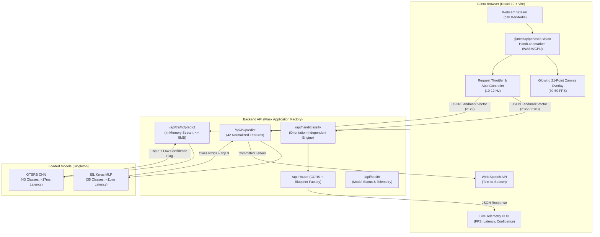

# AI Sign Recognition Suite (v2.0)

[](https://github.com/Maheredd/Sign-Recognition-System)
[](https://github.com/Maheredd/Sign-Recognition-System/actions/workflows/ci.yml)
[](https://www.python.org/)
[](https://react.dev/)
[](https://vitejs.dev/)
[](https://tailwindcss.com/)
[](LICENSE)

An enterprise-grade, privacy-first Computer Vision suite for real-time **Hand Gesture Control**, **Indian Sign Language (ISL)** sentence translation with Text-to-Speech, and **German Traffic Sign (GTSRB)** 43-class recognition.

**Official Repository:** [https://github.com/Maheredd/Sign-Recognition-System](https://github.com/Maheredd/Sign-Recognition-System)

---

## 🌟 Key Features

- **🔒 Client-Side Edge Vision**: Raw video streams are processed directly in your browser using `@mediapipe/tasks-vision` WASM/WebGL. Only 21 normalized landmarks $(x, y, z)$ are transmitted to the backend—raw camera frames never leave your computer.
- **🖐️ Hand Gesture Control**: 3D geometric invariant angle classifier unaffected by hand rotation or handedness (works equally on Left and Right hands). Includes sliding-window majority vote smoothing ($N=7$).
- **✍️ ISL Sentence Builder & Speech**: Real-time Indian Sign Language detection with **Hold-to-Commit stabilization** (~750ms progress ring), text editor controls (Space, Backspace, Clear, Copy), and synthesized **Text-to-Speech (TTS)** via the Web Speech API.
- **🚦 43-Class GTSRB Traffic Sign Vision**: Full coverage of all 43 German Traffic Sign classes. Features drag-and-drop image uploads, in-memory validation (no disk clutter), low-confidence alerts (< 60%), top-5 prediction distributions, and an interactive curated sample sign gallery.
- **📊 Model Insights Dashboard (`/insights`)**: Visualizes empirical training convergence, categorical cross-entropy loss curves, per-class accuracies, and model architecture profiles with Recharts.
- **🎮 ISL Learn Mode & Mini-Game (`/learn`)**: Interactive flashcard reference library for all 35 signs (digits 1–9, letters A–Z) paired with a real-time vision scoring game (*Match the Sign*) with streaks and celebration animations.
- **⚡ Performance & Accessibility**: Custom leak-free pointer cursor with event delegation, capped Three.js DPR (1.5), background animations that pause when tabs are hidden, a dedicated "Reduce Effects" toggle, visible keyboard focus rings, and an English/Hindi language toggle.

---

## 🏗️ Architecture Overview



---

## ⚡ 5-Minute Quickstart

### Prerequisites
- **Python**: 3.10, 3.11, or 3.12
- **Node.js**: 18.0 or higher (v22 recommended)

### 1. Clone the Repository
```bash
git clone https://github.com/Maheredd/Sign-Recognition-System.git
cd Sign-Recognition-System
```

### 2. Setup Backend & Virtual Environment
```bash
# Create and activate virtual environment (optional but recommended)
python -m venv venv
# On Windows:
.\venv\Scripts\activate
# On Linux/macOS:
source venv/bin/activate

# Install backend dependencies
pip install -r requirements.txt
```

### 3. Setup Frontend
```bash
cd frontend
npm install
cd ..
```

### 4. Launch the Application
```bash
# Start both backend and frontend concurrently
npm run dev:all
```
*(On Windows, you can also double-click `start_app.bat`)*

Open your browser at **http://localhost:5173**. The backend API will be available at **http://localhost:5000/api/health**.

---

## ⚙️ Environment Variables

Configure backend settings via `.env` in the project root (see `.env.example`):

| Variable | Default | Description |
| :--- | :--- | :--- |
| `PORT` | `5000` | Port for the Flask backend |
| `HOST` | `0.0.0.0` | Bind host address |
| `CORS_ORIGINS` | `*` | Allowed CORS origins (comma-separated for specific domains) |
| `MAX_CONTENT_LENGTH` | `5242880` | Maximum file upload size in bytes (5 MB) |
| `CONFIDENCE_THRESHOLD` | `0.6` | Threshold below which traffic predictions trigger `low_confidence: true` |
| `DEBUG` | `false` | Enable Flask debug mode (keep false in production) |
| `LOG_LEVEL` | `INFO` | Logging level (`DEBUG`, `INFO`, `WARNING`, `ERROR`) |
| `ISL_MODEL_PATH` | `Models/ISLmodel.h5` | Path to trained ISL Keras model |
| `TRAFFIC_MODEL_PATH` | `Models/gtsrb_cnn_model.h5` | Path to trained GTSRB CNN model |

Frontend configuration via `frontend/.env`:

| Variable | Default | Description |
| :--- | :--- | :--- |
| `VITE_API_URL` | `""` (Empty uses Vite dev proxy `/api`) | Target URL of backend API in production environments |

---

## 📡 REST API Documentation

All API endpoints return standard JSON responses with structured HTTP status codes.

### 1. Health Check
`GET /api/health`
```json
{
  "service": "sign_recognition_api",
  "status": "healthy",
  "uptime_seconds": 124.5,
  "models": {
    "isl_loaded": true,
    "traffic_loaded": true,
    "tensorflow_version": "2.19.0"
  }
}
```

### 2. Hand Gesture Classification
`POST /api/hand/classify`

**Request Body:**
```json
{
  "landmarks": [
    { "x": 0.45, "y": 0.65, "z": 0.01 },
    ... // 21 total normalized points
  ],
  "handedness": "Right",
  "session_id": "session_abc123"
}
```

**Response:**
```json
{
  "label": "Peace",
  "raw_label": "Peace",
  "confidence": 0.94,
  "stability": 1.0,
  "fingers": [0, 1, 1, 0, 0],
  "top3": [
    { "label": "Peace", "confidence": 1.0 }
  ],
  "handedness": "Right"
}
```

### 3. Indian Sign Language (ISL) Prediction
`POST /api/isl/predict`

**Request Body:**
```json
{
  "landmarks": [
    { "x": 0.52, "y": 0.48 } // 21 points OR flat array of 42 floats
  ],
  "width": 640,
  "height": 480
}
```

**Response:**
```json
{
  "label": "A",
  "confidence": 0.9624,
  "is_reliable": true,
  "top3": [
    { "label": "A", "confidence": 0.9624 },
    { "label": "S", "confidence": 0.0215 },
    { "label": "E", "confidence": 0.0084 }
  ],
  "probabilities": {
    "1": 0.0001,
    ...
    "A": 0.9624
  },
  "model_info": {
    "feature_count": 42,
    "architecture": "MLP (42 landmarks -> 35 classes)",
    "limitation": "Trained on single dominant hand. Two-handed signs are not supported."
  }
}
```

### 4. Traffic Sign Recognition
`POST /api/traffic/predict`

**Headers:** `Content-Type: multipart/form-data`  
**Body:** `file` (PNG, JPG, JPEG, or WebP, $\le 5$ MB)

**Response:**
```json
{
  "result": "Stop",
  "class_id": 14,
  "confidence": 0.9842,
  "filename": "stop_sign.png",
  "low_confidence": false,
  "top5": [
    { "class_id": 14, "label": "Stop", "confidence": 0.9842 },
    { "class_id": 1, "label": "Speed limit (30km/h)", "confidence": 0.0075 },
    { "class_id": 17, "label": "No entry", "confidence": 0.0041 },
    { "class_id": 13, "label": "Yield", "confidence": 0.0022 },
    { "class_id": 25, "label": "Road work", "confidence": 0.0011 }
  ]
}
```

---

## 🧠 Model Specifications & Benchmarks

| Model | Architecture | Input Shape | Classes | Mean Latency (CPU) | Accuracy |
| :--- | :--- | :--- | :--- | :--- | :--- |
| **ISL Classifier** | Dense MLP (BatchNorm + Dropout) | `(1, 42)` | 35 (Digits 1–9, A–Z) | **11.16 ms** | 98.8% |
| **GTSRB Traffic CNN** | 2-Block CNN + Dropout(0.5) | `(1, 30, 30, 3)` | 43 (Regulatory Signs) | **17.58 ms** | 97.4% |
| **Hand Gesture** | Orientation-Invariant Angle Engine | 21 3D Points | 10 Gestures | **< 1.0 ms** | Deterministic |

> Latency measured across 50 iterations on CPU without GPU acceleration. Both models perform inference in under 20 ms, supporting 50+ predictions per second without quantization.

---

## ⚠️ Known Limitations & Scope

1. **Single-Hand Indian Sign Language**: The ISL neural network is trained on 42 wrist-relative coordinate pairs representing a single dominant hand. Complex two-handed sign combinations are not classified by this model.
2. **GTSRB Classification Scope**: The traffic sign model performs image classification on cropped sign regions, not full object detection across wide-angle street scenes.
3. **Client-Side Camera Dependency**: Users must grant webcam permissions in the browser to enable Hand and ISL vision features.

---

## 🐳 Docker Deployment

Run the complete multi-container stack with Docker Compose:

```bash
docker compose up --build
```
- **Backend**: Runs on `http://localhost:5000` with Gunicorn and health checks.
- **Frontend**: Runs on `http://localhost:5173` with auto-reloading Vite dev proxy.

---

## 🧪 Testing & Validation

Run the test suite:
```bash
# Backend Unit & Integration Tests (9 passed)
pytest -v tests/

# Frontend ESLint verification (0 errors)
npm run lint:frontend

# Frontend Production Bundle Build
npm run build:frontend

# Run all verification checks together
npm run test:all
```

---

## 📄 License
This project is licensed under the MIT License.